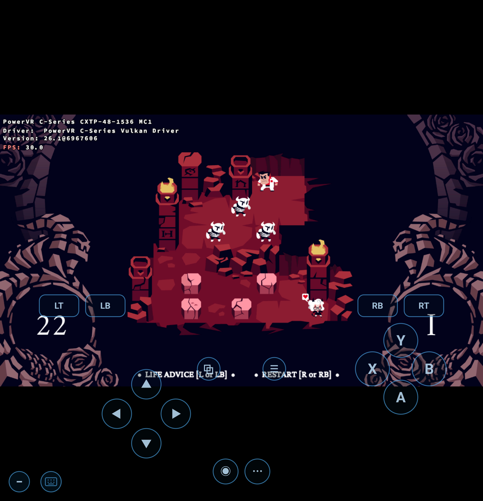

# DXVK presentation-semaphore lifetime without maintenance1

This is a correction to the existing experimental PowerVR branch, not an
independent graphics bridge or a claim of support for every Pixel generation.
The BC conversion and X11 WSI work remains attributed to that branch and its
credited upstreams.

The pinned DXVK source is `25ca63f17f34bdc05a39873ee63907d3cbbfa030`.
Without swapchain maintenance1, its presentation semaphores rotated by frame
slot. A render fence does not establish presentation completion, and a larger
frame ring does not guarantee that a delayed image's previous presentation has
consumed its semaphore. Current Khronos validation reported
`VUID-vkQueueSubmit2-semaphore-03868` during Helltaker on the tested PowerVR device.

The fallback now selects both the render signal and presentation wait semaphore
by acquired swapchain-image index. Waiting on that image's acquire semaphore
orders reuse after its previous presentation. The existing maintenance1
presentation-fence path keeps its frame-slot selection. The build applies both
pinned DXVK patches and archives their combined diff with source/license
provenance. See the [Khronos semaphore reuse guide](https://docs.vulkan.org/guide/latest/swapchain_semaphore_reuse.html).

## Checks

`check_present_sync.py <patched dxvk_presenter.cpp>` extracts the actual signal
and wait selections, compiles them with a native C++ compiler, and replays 200
out-of-order image acquisitions for each path. Its independent ownership oracle
delays image 2 beyond a frame-ring cycle. The original source fails at frame 8;
the corrected fallback and the presentation-fence control both pass on macOS and
native Linux ARM64. This narrow replay is not the full Vulkan presenter.

Both x32 and x64 DLL sets were built successfully. On-device hashes matched the
host fixture, and Helltaker's actual prefix `d3d11.dll`/`dxgi.dll` matched the new
x64 DLLs. The downloaded managed pack and the original Proton depot were not
overwritten; validation used a separate temporary per-game fixture.

| On-device observation | Result |
| --- | --- |
| Original DXVK, current Khronos 1.4.363 layer | Four presentation-semaphore reuse callbacks; both maintenance1 features reported unsupported |
| Patched DXVK, 182.83-second launch observation, 30 FPS cap | Intro and first puzzle rendered; zero core/synchronization errors and no new reboot |
| Patched DXVK, fresh session, 361.68-second launch observation, 30 FPS cap | First puzzle rendered; zero core/synchronization errors and no new reboot |
| Touch controls | Left then right changed the actor's tile and move counter 23→22→21 |

Tested on Pixel 11 Pro Fold / Tensor G6 / PowerVR CXTP-48-1536 MC1, Android 17
API 37, actual 4096-byte pages, vendor Vulkan 1.4.344, Helltaker Windows x64
build 6791993. The current layer's activation control and BC3 readback control
also passed. A representative first-puzzle frame is below.

The observation limits include launcher and intro. They do not establish
uncapped performance, long-duration stability, or a fix for the earlier
`reset,warm,gnoc_error` reboot. BC1 RGB and inherited precision-control issues,
16 KB pages and other GPU families remain unvalidated. GPU-assisted validation
was not enabled. Both temporary configurations were restored byte for byte;
the final managed choice is Standard and the new test fixture is inactive.

The managed-pack manifest pins the corrected DXVK archive and each installed
DLL's size and checksum. Existing Experimental selections keep their old pack
after an APK upgrade: choose **Update Experimental** under **Steam settings >
Display > Drivers > Steam graphics**, then restart the game. Installing the APK
does not replace a previously selected pack or enable Experimental automatically.
